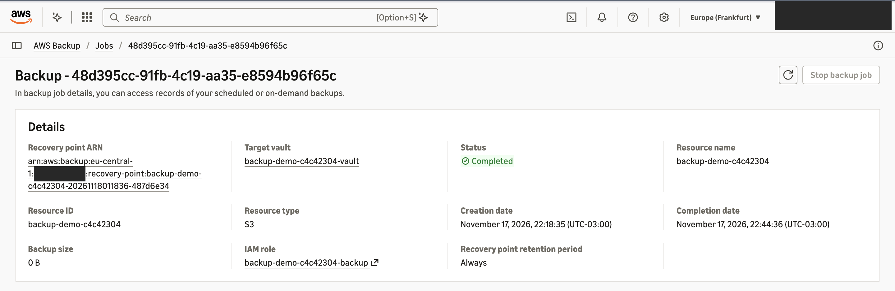

# terraform-aws-s3-backup

Versioned, encrypted S3 backup bucket with daily AWS Backup, in one reusable Terraform module.

## What it creates

- **S3 bucket** with versioning, server-side encryption (SSE-S3), all public access blocked and ACLs disabled
- **Lifecycle rule** that deletes old object versions after a configurable number of days and cleans up incomplete multipart uploads
- **AWS Backup** vault, daily backup plan with configurable retention, and the IAM role AWS Backup needs for S3
- **Read-only IAM policy** you can attach to users or groups that need access to the bucket (including listing it in the AWS console)

## Usage

```hcl
module "s3_backup" {
  source = "github.com/fynndow/terraform-aws-s3-backup//modules/s3-backup"

  bucket_name           = "my-company-backups"
  backup_retention_days = 35

  tags = {
    Project = "my-project"
  }
}

# Give a team member read access to the bucket
resource "aws_iam_group_policy_attachment" "backup_readers" {
  group      = "backup-readers"
  policy_arn = module.s3_backup.read_only_policy_arn
}
```

A complete, runnable example is in [`examples/basic`](examples/basic).

## Inputs

| Name | Description | Type | Default |
| --- | --- | --- | --- |
| `bucket_name` | Globally unique name of the backup bucket | `string` | required |
| `backup_schedule` | AWS Backup schedule (UTC) | `string` | `cron(0 3 * * ? *)` |
| `backup_retention_days` | Number of days backups are kept in the vault (min. 1) | `number` | `35` |
| `noncurrent_version_days` | Days after which noncurrent object versions are deleted | `number` | `30` |
| `force_destroy` | Delete bucket and vault including all contents on destroy (demo use only) | `bool` | `false` |
| `tags` | Tags applied to all resources | `map(string)` | `{}` |

## Outputs

| Name | Description |
| --- | --- |
| `bucket_name` | Name of the backup bucket |
| `bucket_arn` | ARN of the backup bucket |
| `backup_vault_name` | Name of the AWS Backup vault that stores the recovery points |
| `backup_role_arn` | ARN of the IAM role AWS Backup uses to back up and restore the bucket |
| `read_only_policy_arn` | ARN of the read-only IAM policy |

## Tests

The module is tested with `terraform test` and a mocked AWS provider, so the tests run without AWS credentials and at no cost:

```bash
cd modules/s3-backup
terraform init
terraform test
```

The tests check that:

- versioning is enabled (required by AWS Backup for S3)
- public access is fully blocked
- the backup plan uses the configured retention
- a retention of 0 days is rejected

Every push runs `terraform fmt`, `tflint`, `terraform validate` and the tests in GitHub Actions.

## Try it out

```bash
cd examples/basic
terraform init
terraform plan -out=tfplan
terraform apply tfplan

# Upload a test file
echo "hello" > test.txt
aws s3 cp test.txt s3://$(terraform output -raw bucket_name)/

# Start a backup right away instead of waiting for the schedule
aws backup start-backup-job \
  --backup-vault-name $(terraform output -raw vault_name) \
  --resource-arn $(terraform output -raw bucket_arn) \
  --iam-role-arn $(terraform output -raw backup_role_arn) \
  --lifecycle DeleteAfterDays=7
```

On-demand backup jobs do not use the retention rule of the backup plan. Without `--lifecycle`, the recovery point is kept forever. The first backup of a bucket can take up to an hour, even for small files.

A completed on-demand backup of the example bucket:



## Costs and cleanup

With a few test files, running the example costs a few cents. AWS Backup charges for stored backup data, S3 for stored objects.

Remove everything when you are done:

```bash
cd examples/basic
terraform destroy
```

The example sets `force_destroy = true`, so the bucket contents and recovery points are deleted as well. Keep the default `false` for real backups.

## Requirements

| Name | Version |
| --- | --- |
| Terraform | >= 1.7 |
| AWS provider | >= 5.0 |

## License

MIT
